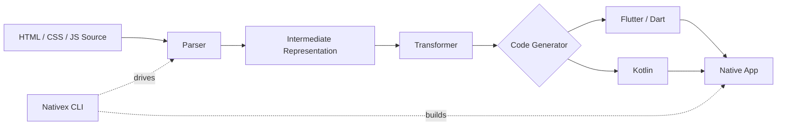

# Nativex

> Write once in HTML, CSS, and JavaScript. Compile into native applications.

Nativex is an experimental, Rust-powered compiler designed to transform web technologies into native applications using frameworks like Flutter and Kotlin.

The goal is to make cross-platform app development more accessible without sacrificing the power of native application frameworks.

## Vision

- **Rust-powered compiler** for parsing, transformation, and code generation.
- **HTML & CSS** for UI structure and styling.
- **JavaScript** for application logic and interactions.
- **Cross-platform output**, starting with Flutter and potentially Kotlin.
- **Developer-first CLI** for generating and building applications.

## How It Works

## Status

🚧 **Under active development.** Nativex is currently a concept, and its compiler, runtime, and code-generation pipeline are yet to be implemented.

## License

MIT License. See [LICENSE](LICENSE) for details.
